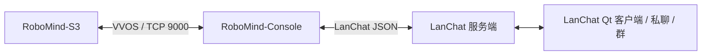

# RoboMind-Console

**RoboMind 系列的 PC 可视化与协议桥。** 使用 Qt6 / C++ 接收 ESP32-S3 的 PPM 感知状态，将告警送到 LanChat 私聊或群，并向板端下发文字消息和页面操作。

这是个人独立项目中的配套工具。感知决策由 PPM 承担；Console 负责通信、展示和操作。

> 当前状态：2026-11-21。群发告警与终端下行桥已完成，功能提交为 `1145890`；LanChat 集成时 Console 在后台运行，操作面板展示在 LanChat 主窗口中。

## 当前功能

| 能力 | 状态 |
|---|---|
| TCP 接入 | 监听板端连接，解析半包 / 粘包和 VVOS 11 字段信封，显示 PPM 状态 |
| 告警私聊 / 群发 | `target` / `group_id` 控制目标；双目标各发一份，对一次告警只记一次 30 秒去抖 |
| 文字下行 | 接收专用 LanChat 账号的私聊 / 配置群消息，经 VVOS 送入 S3 收件箱 |
| 投递状态 | 有界队列、TTL、重试 / 判重，以及 accepted / rendered / rejected / expired 状态 |
| 页面控制 | 总览 / 收件箱 / PPM / VVOS / 设备，以及详情、滚动、本地已读、中英文切换 |
| 后台桥 | 本机原子状态文件和页面请求；Windows 临时读锁写入失败可重试 |
| 独立验证 | selfcheck、framecheck、无窗口接收工具和独立假服务端下行测试 |

## 系列链路



上行：摄像头 → PPM → S3 → Console → LanChat 告警。

下行：PC 文字消息 → LanChat 服务端 → Console → S3 显示；板端回传投递 / 显示状态。页面控制也使用现有 VVOS 连接。

- 板端仅承担 VVOS 网络协议；LanChat 登录、JSON 和心跳留在 Console 桥。
- GUI 宿主可为 LanChat 的内嵌板端面板，Console 作为后台进程运行。
- S3 `rendered` 代表可见预览或详情完成 LVGL / LCD DMA 刷新，独立于人类阅读回执。

配套仓库：[RoboMind-S3](https://github.com/Nagi-226/RoboMind-S3)、[LanChat-Next](https://github.com/Nagi-226/LanChat-Next)、[Virtual-Vehicle-OS](https://github.com/Nagi-226/Virtual-Vehicle-OS)、[PPM](https://github.com/Nagi-226/PPM)。

## 使用方式

### 从 LanChat 主窗口使用

在 LanChat-Next 点击 **板端连接**，配置 / 启动桥，直接查看状态、发消息和切换板端页面。无需再打开单独的 Console 窗口。

LanChat 部署脚本会将 Console 的正式 `build/dist/` 产物复制到 `%LOCALAPPDATA%\LanChat-Qt\robomind-console\`。桥账号由客户端独立管理，避免占用人类聊天账号的连接。

说明：[LanChat 板端面板](https://github.com/Nagi-226/LanChat-Next/blob/master/docs/board-panel.md)。

### 单独运行 Console

构建并部署后运行：

```powershell
.\build\dist\RoboMindConsole.exe --port 9000
```

S3 需连接到这台 PC 的局域网 IP / TCP 9000；检查对应防火墙规则。另一台机器的连通性检查比本机 loopback 更能说明局域网接入情况。

### LanChat 桥配置

配置文件先读取当前工作目录的 `robomind-console.ini`，不存在时读取 exe 目录。可从 [robomind-console.ini.example](robomind-console.ini.example) 开始。

```ini
[lanchat]
enabled=true
host=127.0.0.1
port=12346
target=0
group_id=1
receive_messages=true
```

| 配置 | 默认 | 含义 |
|---|---|---|
| `enabled` | false | 启用 LanChat 桥 |
| `host` | 127.0.0.1 | LanChat 服务端地址 |
| `port` | 9001 | 独立测试默认端口；正式 LanChat 通常配置为 12346 |
| `target` | 0 | 私聊告警接收者的数字 ID，0 不发私聊 |
| `group_id` | 0 | 群告警 / 配置群接收的群 ID，0 不使用群 |
| `receive_messages` | false | 接收私聊 / 配置群文字消息，桥接到板端 |

- `target > 0` 与 `group_id > 0` 同时配置：群和私聊各发一帧，最后只记录一次去抖。
- 只配一个目标：只发往对应目标。
- 两个目标均为 0：不转发告警；启用 `receive_messages` 时仍可仅接收消息。

手动运行时，使用预先注册的专用桥账号。凭据仅从进程环境变量读取：

```text
ROBOMIND_LANCHAT_USER_ID     数字账号 ID
ROBOMIND_LANCHAT_PASSWORD    该账号密码
```

不要把真实凭据写入配置模板、argv 或仓库。LanChat 集成模式会为桥子进程提供凭据，保存的密码由 Windows DPAPI 保护。

## 构建与部署

依赖 Qt6、MinGW、CMake / Ninja 和本地 Virtual-Vehicle-OS 仓库。

```powershell
$env:PATH = 'D:\Qt\Tools\mingw1310_64\bin;D:\Qt\6.10.3\mingw_64\bin;' + $env:PATH
cmake -S . -B build -G Ninja `
  -DCMAKE_C_COMPILER=D:/Qt/Tools/mingw1310_64/bin/gcc.exe `
  -DCMAKE_CXX_COMPILER=D:/Qt/Tools/mingw1310_64/bin/g++.exe `
  -DCMAKE_PREFIX_PATH=D:/Qt/6.10.3/mingw_64 `
  '-DVVOS_ROOT=E:/Github Project/Virtual-Vehicle-OS'
cmake --build build --target robomind-console deploy
```

**正式 GUI 产物始终是 `build/dist/RoboMindConsole.exe`。** `deploy` 将 Qt DLL / plugins 放到 exe 旁；分发应包含整个目录。

`VVOS_ROOT` 是路径依赖，不是版本锁。本轮配套验证使用 VVOS `e2c2b2a`、S3 `7ad1629`、LanChat `088f4d1`。搬目录时重新配置 cache 或使用新的构建目录；只改路径变量不能假定旧 cache 已更新。

## 验证与已知边界

### 可运行的独立检查

```powershell
.\build\selfcheck.exe
.\build\framecheck.exe testdata\frames_fixed.bin
# 负向对照：此文件应被拒绝，退出码非 0
.\build\framecheck.exe testdata\frames_buggy.bin
py tools/test_display_bridge.py
```

- `selfcheck` 独立于 GUI，便于读取 stdout 和退出码。
- `framecheck` 使用真实 VVOS MessageCodec 解码抓包；“收到字节”不等于协议解码正确。
- [test_display_bridge.py](tools/test_display_bridge.py) 用独立假 LanChat / 假板端驱动真实 Console，覆盖中文 / 转义、接收者过滤、拆包 ACK、重试、判重、尺寸、重连、页面操作及回执。

### 本轮已验证

2026-11-21 完整构建 / 部署通过；群、私聊、双发、去抖和无目标的上行运行回归 **6/6**；独立下行测试通过。实际 LanChat → Console → ESP32-S3 中文消息、五页 / 详情 / 滚动 / 已读 / 语言和 `rendered` 回执通过。

完整实板记录：[S3 终端初版验收](https://github.com/Nagi-226/RoboMind-S3/blob/master/docs/terminal_v1_acceptance.md)。这些为本轮本机验收记录，不代表远端 CI 或未经执行的多机测试。

### 边界

- 板端正文最多 **384 字节 UTF-8**、最多 **8 条**收件；PC 图片 / 文件传输扩展使用独立附件通道。
- 当前仅一个活动板端连接，未验收多板 / 多 Console 协同。
- S3 触摸未实现，当前页面操作来自 PC；字体 / 背光 / 颜色仍需物理屏幕目检。
- 本机 LanChat 服务端包含保留的未提交修复，完整复现现部署需单独收口服务端。

## 协议与目录

VVOS MessageCodec 是信封契约的来源。S3 的 [wire_codec](https://github.com/Nagi-226/RoboMind-S3/blob/master/main/wire_codec.cpp) / [terminal_protocol](https://github.com/Nagi-226/RoboMind-S3/blob/master/main/terminal_protocol.cpp) 是板端实现；变更信封时同步协议测试、抓包正反例及两端实现。

```text
src/mainwindow.*     TCP 接入、PPM 状态展示、显示桥接入
src/lanchat_sink.*   LanChat 登录、群 / 私聊告警及消息接收
src/display_bridge.* 有界投递、TTL、回执、页面控制
src/frame_stream.h  流式切帧
src/selfcheck.cpp   解码向量自检
src/framecheck.cpp  正反抓包校验
src/headless*       独立无窗口接收工具
assets/             图标源、PNG / ICO 和 PE 资源模板
testdata/           正反例帧
tools/              独立假服务端、重放及下行验证
```

M1 / M2 / M3 的历史验收、图标排错和旧资源数据可查 [此前 README](https://github.com/Nagi-226/RoboMind_Console/blob/0407fb0/README.md)；当前双向桥能力以本 README 为准。
