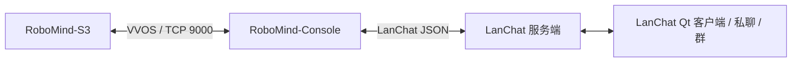

# RoboMind-Console

**RoboMind 系列的 PC 可视化与协议桥。** 使用 Qt6 / C++ 接收 ESP32-S3 的 PPM 感知状态，将告警送到 LanChat 私聊或群，并向板端下发文字消息和页面操作。

这是个人独立项目中的配套工具。感知决策由 PPM 承担；Console 负责通信、展示和操作。

> 当前状态：2026-11-27。DS、GPT 可用独立 LanChat 账号同时登录，共用一条 S3 连接并分别回答真实状态。向其中一个账号发出私聊文字后，屏幕自动切到对应角色，字幕和语音等待板端确认。源码支持此功能；完整 LanChat 安装包仍为 2026.11.23.2。

## 当前功能

| 能力 | 状态 |
|---|---|
| TCP 接入 | 监听板端连接，解析半包 / 粘包和 VVOS 11 字段信封，显示 PPM 状态 |
| 告警私聊 / 群发 | `target` / `group_id` 控制目标；双目标各发一份，对一次告警只记一次 30 秒去抖 |
| 文字下行 | 接收专用 LanChat 账号的私聊 / 配置群消息，经 VVOS 送入 S3 收件箱 |
| 投递状态 | 有界队列、TTL、重试 / 判重，以及 accepted / rendered / rejected / expired 状态 |
| 页面控制 | 总览 / 收件箱 / PPM / VVOS / 设备，以及详情、滚动、本地已读、中英文切换 |
| 关键词查询 | 感知 / 链路 / 设备 / 帮助；有界请求、状态校验、按原私聊 / 配置群回复、离线 / 超时 / 限流 |
| AI 状态问答 | Anthropic / OpenAI 兼容接口；DS 与 GPT 各自私聊与上下文，通过同一条 S3 连接查询实时快照，回复原会话 |
| 沉浸语音桥 | 可选 Windows 中文 / 本地 VITS 少女语音，字幕按板端字库排成两行；TCP_NODELAY 配合 S3 缓存背压发送 PCM，下一段等待当前段完成，退出 / 停止 / 新问题可取消 |
| USB 运行日志 | 独立串口线程、UTF-8 / ANSI 分行、脱敏有界缓存与滚动历史；四种 `/日志` 命令在原会话回复 |
| 后台桥 | 本机原子状态文件和页面请求；Windows 临时读锁写入失败可重试 |
| 独立验证 | selfcheck、framecheck、无窗口接收工具和独立假服务端下行测试 |

## 系列链路



上行：摄像头 → PPM → S3 → Console → LanChat 告警。

下行：PC 文字消息 → LanChat 服务端 → Console → S3 显示；板端回传投递 / 显示状态。页面控制也使用现有 VVOS 连接。

- 板端仅承担 VVOS 网络协议；LanChat 登录、JSON 和心跳留在 Console 桥。
- GUI 宿主可为 LanChat 的内嵌板端面板，Console 作为后台进程运行。
- S3 `rendered` 代表可见预览或详情完成 LVGL / LCD DMA 刷新，独立于人类阅读回执。

配套仓库：[RoboMind-S3](https://github.com/Nagi-226/RoboMind-S3)、[LanChat-Next](https://github.com/Nagi-226/LanChat-Next)、[Virtual-Vehicle-OS](https://github.com/Nagi-226/Virtual-Vehicle-OS)、[PPM](https://github.com/Nagi-226/PPM)。

## 使用方式

### 从 LanChat 主窗口使用

在 LanChat-Next 点击 **板端连接**，配置 / 启动桥，直接查看状态、发消息和切换板端页面。无需再打开单独的 Console 窗口。

LanChat 部署脚本会将 Console 的正式 `build/dist/` 产物复制到 `%LOCALAPPDATA%\LanChat-Qt\robomind-console\`。桥账号由客户端独立管理，避免占用人类聊天账号的连接。

说明：[LanChat 板端面板](https://github.com/Nagi-226/LanChat-Next/blob/master/docs/board-panel.md)。

角色模式从登录后的齿轮设置进入。DS 对应鲸鱼娘，GPT 对应白龙娘，双登录时发送私聊文字即可切换；也可以手动选角色。Console 的 `SpeechBridge` 管理扬声器和本机 TTS，完整回答留在 PC 原会话。详见[双账号问答说明](docs/ai-status-chat.md)及[沉浸模式说明](https://github.com/Nagi-226/LanChat-Next/blob/master/docs/whale-immersion-plan.md)。

### 单独运行 Console

构建并部署后运行：

```powershell
.\build\dist\RoboMindConsole.exe --port 9000
```

S3 需连接到这台 PC 的局域网 IP / TCP 9000；检查对应防火墙规则。另一台机器的连通性检查比本机 loopback 更能说明局域网接入情况。

### LanChat 桥配置

配置文件先读取当前工作目录的 `robomind-console.ini`，不存在时读取 exe 目录。可从 [robomind-console.ini.example](robomind-console.ini.example) 开始。

```ini
[lanchat]
enabled=true
host=127.0.0.1
port=12346
target=0
group_id=1
receive_messages=true
```

| 配置 | 默认 | 含义 |
|---|---|---|
| `enabled` | false | 启用 LanChat 桥 |
| `host` | 127.0.0.1 | LanChat 服务端地址 |
| `port` | 9001 | 独立测试默认端口；正式 LanChat 通常配置为 12346 |
| `target` | 0 | 私聊告警接收者的数字 ID，0 不发私聊 |
| `group_id` | 0 | 群告警 / 配置群接收的群 ID，0 不使用群 |
| `receive_messages` | false | 接收私聊 / 配置群文字消息，桥接到板端 |

- `target > 0` 与 `group_id > 0` 同时配置：群和私聊各发一帧，最后只记录一次去抖。
- 只配一个目标：只发往对应目标。
- 两个目标均为 0：不转发告警；启用 `receive_messages` 时仍可仅接收消息。

手动运行时，使用预先注册的专用桥账号。凭据仅从进程环境变量读取：

```text
ROBOMIND_LANCHAT_USER_ID     数字账号 ID
ROBOMIND_LANCHAT_PASSWORD    该账号密码
```

不要把真实凭据写入配置模板、argv 或仓库。LanChat 集成模式会为桥子进程提供凭据，保存的密码由 Windows DPAPI 保护。

## 构建与部署

依赖 Qt6（含 SerialPort）、MinGW、CMake 3.22+ / Ninja 和本地 Virtual-Vehicle-OS 仓库。

```powershell
$env:PATH = 'D:\Qt\Tools\mingw1310_64\bin;D:\Qt\6.10.3\mingw_64\bin;' + $env:PATH
cmake -S . -B build -G Ninja `
  -DCMAKE_C_COMPILER=D:/Qt/Tools/mingw1310_64/bin/gcc.exe `
  -DCMAKE_CXX_COMPILER=D:/Qt/Tools/mingw1310_64/bin/g++.exe `
  -DCMAKE_PREFIX_PATH=D:/Qt/6.10.3/mingw_64 `
  '-DVVOS_ROOT=E:/Github Project/Virtual-Vehicle-OS'
cmake --build build --target robomind-console deploy
```

**正式 GUI 产物始终是 `build/dist/RoboMindConsole.exe`。** `deploy` 将 Qt DLL / plugins 放到 exe 旁；分发应包含整个目录。

`VVOS_ROOT` 是路径依赖，不是版本锁。2026-11-21 配套验证基线为 VVOS `e2c2b2a`、S3 `7ad1629`、LanChat `088f4d1`；2026-11-23 主分支更新见下文。搬目录时重新配置 cache 或使用新的构建目录；只改路径变量不能假定旧 cache 已更新。

## 验证与已知边界

### 可运行的独立检查

```powershell
.\build\selfcheck.exe
.\build\framecheck.exe testdata\frames_fixed.bin
# 负向对照：此文件应被拒绝，退出码非 0
.\build\framecheck.exe testdata\frames_buggy.bin
py tools/test_display_bridge.py
```

- `selfcheck` 独立于 GUI，便于读取 stdout 和退出码。
- `framecheck` 使用真实 VVOS MessageCodec 解码抓包；“收到字节”不等于协议解码正确。
- [test_display_bridge.py](tools/test_display_bridge.py) 用独立假 LanChat / 假板端驱动真实 Console，覆盖中文 / 转义、接收者过滤、拆包 ACK、重试、判重、尺寸、重连、页面操作及回执。

### 本轮已验证

2026-11-21 完整构建 / 部署通过；群、私聊、双发、去抖和无目标的上行运行回归 **6/6**；独立下行测试通过。实际 LanChat → Console → ESP32-S3 中文消息、五页 / 详情 / 滚动 / 已读 / 语言和 `rendered` 回执通过。

完整实板记录：[S3 终端初版验收](https://github.com/Nagi-226/RoboMind-S3/blob/master/docs/terminal_v1_acceptance.md)。这些为本轮本机验收记录，不代表远端 CI 或未经执行的多机测试。

### 边界

- 板端正文最多 **384 字节 UTF-8**、最多 **8 条**收件；PC 图片 / 文件传输扩展使用独立附件通道。
- 当前仅一个活动板端连接，未验收多板 / 多 Console 协同。
- S3 触摸未实现，当前页面操作来自 PC；字体 / 背光 / 颜色仍需物理屏幕目检。
- LanChat 服务端必要修复已随 PC LAN 初版提交（`f93288a`）；配套客户端现含文字 AI 和登录后六组设置，Windows 分发版本为 2026.11.23.2，产物与验收见 [LanChat 发布记录](https://github.com/Nagi-226/LanChat-Next/blob/master/docs/windows-release-20261123.md)。当前聊天 TCP 尚无 TLS，适用于可信 LAN 或加密组网。

## 协议与目录

VVOS MessageCodec 是信封契约的来源。S3 的 [wire_codec](https://github.com/Nagi-226/RoboMind-S3/blob/master/main/wire_codec.cpp) / [terminal_protocol](https://github.com/Nagi-226/RoboMind-S3/blob/master/main/terminal_protocol.cpp) 是板端实现；变更信封时同步协议测试、抓包正反例及两端实现。

```text
src/mainwindow.*     TCP 接入、PPM 状态展示、显示桥接入
src/lanchat_sink.*   LanChat 登录、群 / 私聊告警及消息接收
src/display_bridge.* 有界投递、TTL、回执、页面控制
src/status_query.*   只读命令识别、实板快照、原会话回复与判重
src/frame_stream.h  流式切帧
src/selfcheck.cpp   解码向量自检
src/framecheck.cpp  正反抓包校验
src/headless*       独立无窗口接收工具
assets/             图标源、PNG / ICO 和 PE 资源模板
testdata/           正反例帧
tools/              独立假服务端、重放及下行验证
```

M1 / M2 / M3 的历史验收、图标排错和旧资源数据可查 [此前 README](https://github.com/Nagi-226/RoboMind_Console/blob/0407fb0/README.md)；当前双向桥能力以本 README 为准。

## PC 富媒体隔离（2026-11-21）

LanChat Qt 已实现 PC 间图片、GIF 和文件传输。Console 的 LanChatSink 与 DisplayBridge 两层入口仅允许 text，拒绝 image/file/sticker 及任何 attachment 字段；这些内容不下发容量有限的 S3。原有中文文字、群/私聊告警、显示回执和页面控制保留。

独立验证 `python tools/test_display_bridge.py` 增加非文字及附件伪装用例。PC 分发与共享主机操作见 [LanChat 局域网部署](https://github.com/Nagi-226/LanChat-Next/blob/master/docs/lan-deployment.md)。本轮无需修改或烧录 S3 固件。

## USB 板端运行日志（2026-11-23）

LanChat 本体的 **板端连接 → 运行日志** 使用此桥的独立串口线程，读取板端现有 ESP_LOG 与 printf。选择实际 USB Serial/JTAG 端口并开始采集；本机为 COM3、115200，无需修改或烧录 S3。停止采集释放端口；占用、断开和停采保留历史，端口不可用时每 2 秒重试。

所有展示、滚动文件、复制、导出和聊天查询共用脱敏缓存。单行最多 2 KiB；缓存最多 2,000 行 / 4 MiB，历史 5 MiB × 4。快照使用独立的 `logs/logs.snapshot.json`，桥 `status.json` 只增加日志状态 / 计数。日志来源会话与端口逐行记录；时间为 PC 接收时间。采集前、断开或驱动丢失的输出无法补取。

`/日志`、`/日志 错误`、`/日志 链路`、`/日志 帮助` 在专用账号私聊和配置群中完整匹配，沿用原会话路由、判重、750 ms 限流和自身 / 附件过滤。默认返回最多 20 条、排除 hex，单次总回复最多 6 KiB；采集不可用时明确标记历史，没记录不等于板端正常。聊天命令只查询，不控制串口或板子。

USB 实时面板仅在连接板子的主机使用。其他 PC 可经 LanChat 查询片段；纯 Wi-Fi 事件上行与远程连续订阅留后续。Console 自身账号日志不作为板端日志来源，数据不进入安装包。Qt SerialPort SDK 必须与 Qt/编译器版本匹配；部署需包含 `Qt6SerialPort.dll`。

复现检查（使用临时账号和数据库）：

```powershell
cmake --build build --target board-log-check robomind-console deploy
ctest --test-dir build -R '^board_logs$' --output-on-failure
python tools/test_status_queries.py
python tools/test_board_logs.py --server '../LanChat-Next/build/server-mingw/src/server/lanchat_server_next.exe' --port COM3
```

`board-log-check` 覆盖逐字节 UTF-8 / ANSI、printf、脱敏、超长恢复、有界缓存和停采。真实 COM3 检查覆盖服务端私聊 / 群路由、原消息 ID、回复上限、停采后的历史、端口占用与恢复、文件轮换。Qt 本体页另有 `board_logs` 测试与可选 `--qt-probe` 真板验收入口。

2026-11-23 实测：上述检查通过；安装包内 Console / Qt 运行库完成实际 USB 采集与本体页单次聊天回复，隔离账号 / 数据库中采集 44 行。没有用模拟日志替代真板证据。当前固件和 PPM 数据生产路径未修改；直接 USB 读取不增加 S3 运行内存。

## 2026-11-23 主分支更新

日志初版从 `codex/board-runtime-logs` 快进合入 master 并推送：Console [`aebe932`](https://github.com/Nagi-226/RoboMind_Console/commit/aebe9323503ff1f9f7d47f4f61aea1a7f6d413b1)、LanChat [`e99ab22`](https://github.com/Nagi-226/LanChat-Next/commit/e99ab220e63e58bc0abcd43654ac1033f58b8aad)。S3 沿用 `7e6d195`，本轮日志不需要固件变更。

本次合入前，缓存检查、状态查询回归和真实 LanChat 服务端的日志私聊 / 群回复检查通过，使用临时账号与历史缓存；此前 COM3 实板证据保留，不把此次历史缓存检查写成新的 USB 验收。LanChat Qt 14/14 通过，支持日志页自动跟随及统一窗口图标；实际拖拽吸附、Snap 悬停和多屏仍待实机确认。

运行日志页的展示与操作见 [LanChat README 界面预览](https://github.com/Nagi-226/LanChat-Next#界面预览)，图片明确为示例日志。Console 自身继续作为后台采集与通信桥。

## 文字自由问答（2026-11-23）

登录 LanChat 后，在 **左下角齿轮 → 设置 → 板端连接 → AI 状态问答** 配置模型并启用。私聊专用板端账号可直接询问“现在感知情况怎么样”“内存够用吗”，配置群使用 `/AI 问题`；`/AI 清空` 清除当前会话模型上下文。每次回答前刷新感知、链路、设备快照，保留未计算 / 过期 / 离线语义；回答留在 PC 聊天。密钥由 LanChat 用 Windows DPAPI 加密保存。

模型上下文最多三轮、10 分钟无活动过期，聊天历史继续按 LanChat 持久化。模型不获得图像、附件、完整日志、密钥或设备控制工具。默认每请求 1200 输出 token / 45 秒、每日 100 次，LanChat 设置可调整输出、超时、次数、间隔与并发；次数与 token 记录不等于服务商账单。HTTP 429 分类并按 Retry-After 冷却，不自动付费重试。实现、限制、验证与语音 / 小智待办见 [AI 状态问答](docs/ai-status-chat.md)。

## 查询反馈与下一步（2026-11-22）

- **四项只读查询已实施并部署**。私聊完整匹配关键词 / 同义词，配置群要求 `/命令`；有界请求和严格状态校验，保留有效性、采样时间、离线 / 超时、判重、限流与机器人循环过滤。原查询的显示回执和聊天回复分别记录。
- **Tailscale 本机接入已完成**。LanChat 主机保持在线，S3 保持本地 Wi-Fi → Console；当前只有一台可配合的 PC，异地两机登录、群聊、附件和掉线恢复待验。
- **文字模型问答已进入 PC / Console**。通过明确的只读接口取得设备状态，返回原聊天；S3 不运行聊天大模型。语音、小智通用 AI 与实际控制权限继续作为后续阶段。

独立 `tools/test_status_queries.py` 通过（包含并发上限和限流），原 `tools/test_display_bridge.py` 回归通过；`tools/test_real_status_queries.py` 使用隔离账号 / DB 和真实 S3，验证四项私聊与一次群聊，5 条单次回复保存到历史，invalid=0。协议与资源见 [S3 查询协议](https://github.com/Nagi-226/RoboMind-S3/blob/master/docs/status-query-protocol.md)。跨仓进度和下一步统一维护在[实施清单](https://github.com/Nagi-226/LanChat-Next/blob/master/docs/next-steps-20261122.md)。

本地少女声线及研究结果：[声线来源与安装](https://github.com/Nagi-226/LanChat-Next/blob/master/docs/whale-voice.md)。模型、环境与本机路径独立安装，不随公共安装包分发。
